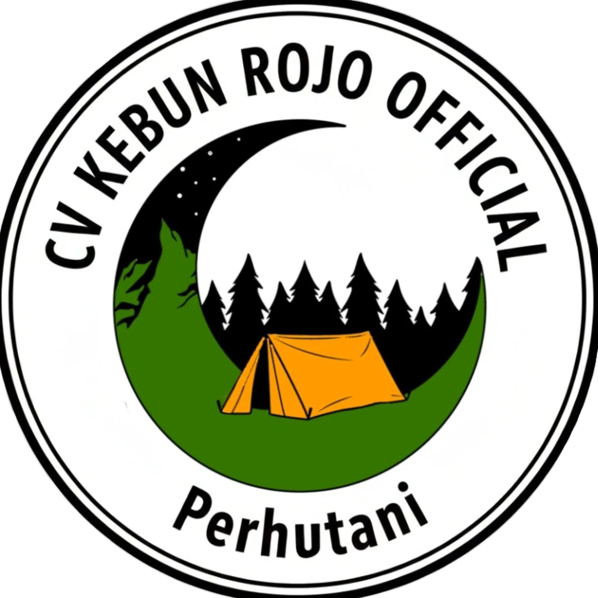
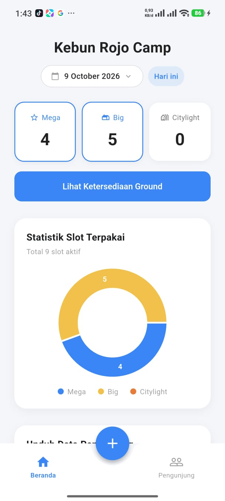
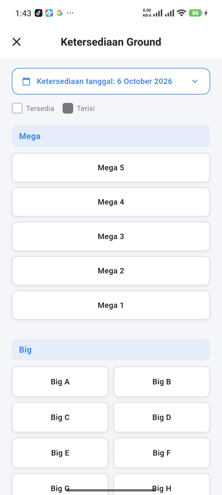
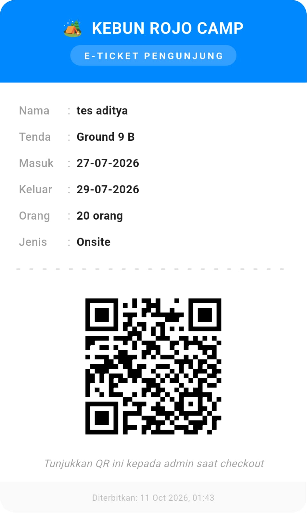
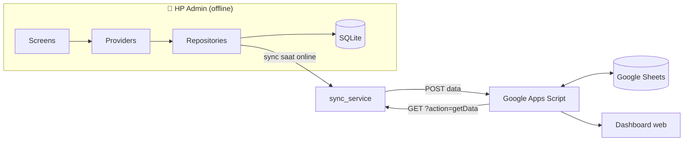

<div align="center">



# Rojo Camp

**Aplikasi pencatatan pengunjung camping ground yang tetap jalan tanpa internet.**

Pengganti buku tamu untuk Kebun Rojo Camp: catat rombongan, pilih slot tenda dari denah interaktif,
kirim e-ticket QR lewat WhatsApp, dan *check-out* cukup dengan scan. Data disimpan di HP dan
di-*backup* ke Google Sheets saat ada sinyal.


</div>

---

## Latar Belakang

Kebun Rojo Camp sebelumnya mencatat pengunjung di buku tulis. Hasilnya: susah mengecek tenda mana
yang masih kosong, rawan *double-booking*, dan rekap bulanan harus dihitung manual. Sinyal di lokasi
juga sering hilang, jadi aplikasi berbasis cloud penuh tidak bisa diandalkan.

Rojo Camp dibuat dengan prinsip **offline-first**. Semua fungsi inti berjalan di HP admin tanpa
internet, dan sinkronisasi ke cloud hanya berfungsi sebagai *backup*.

## Fitur

| | Fitur | Keterangan |
|---|---|---|
| 🗺️ | **Denah tenda interaktif** | 46 slot dalam 3 kategori (Mega, Big, Citylight). Slot yang sudah dipesan di tanggal yang bentrok otomatis dikunci. |
| 🧺 | **Multi-slot** | Satu rombongan bisa memesan beberapa slot dari kategori berbeda sekaligus. |
| 📝 | **Reservasi & Onsite** | Mendukung booking lewat WhatsApp maupun pengunjung yang datang langsung. |
| 🎫 | **E-ticket QR** | QR unik per rombongan, bisa dibagikan sebagai gambar lewat WhatsApp. |
| 📷 | **Check-out via scan** | Scan QR saat pengunjung pulang, status berubah ke *Non-Aktif* dan slot terbuka lagi. |
| 📊 | **Statistik** | Jumlah slot terpakai per kategori dan donut chart, dengan filter tanggal. |
| 📤 | **Ekspor CSV** | Unduh laporan pengunjung berdasarkan rentang tanggal. |
| ☁️ | **Backup Google Sheets** | Sinkronisasi dua arah lewat Google Apps Script: kirim data ke Sheets dan tarik kembali ke HP. |
| 📴 | **Offline-first** | Input, denah, QR, dan scan tetap berfungsi tanpa sinyal. |

## Screenshot

| Beranda | Ketersediaan Ground | E-ticket |
|:---:|:---:|:---:|
|  |  |  |

## Arsitektur



- **Lapisan data**: `sqflite` dengan model `Pengunjung` dan `SlotTenda` (relasi *many-to-many*).
  Setiap record punya flag `synced` agar hanya data baru yang dikirim.
- **State management**: `provider`.
- **Backend tanpa server**: Google Apps Script ([`Code.gs`](Code.gs)) sebagai Web App, ditambah
  halaman [`Dashboard.html`](Dashboard.html) untuk melihat data dari browser. Biaya operasional Rp0.

## Tech Stack

| Kebutuhan | Paket |
|---|---|
| Database lokal | `sqflite`, `path` |
| State management | `provider` |
| QR | `qr_flutter` (generate), `mobile_scanner` (scan) |
| Grafik | `fl_chart` |
| Share & ekspor | `share_plus`, `path_provider` |
| Sinkronisasi | `http`, `connectivity_plus`, `shared_preferences` |
| Utilitas | `uuid`, `intl` |

## Struktur Proyek

```
lib/
├── config/          # Konfigurasi (URL Apps Script) — app_config.dart di-gitignore
├── data/
│   ├── database/    # Helper SQLite + seed data slot tenda
│   ├── models/      # Pengunjung, SlotTenda
│   └── repositories/
├── providers/       # State management
├── screens/         # home, daftar, detail, tambah, denah_tenda, scan_qr
├── services/        # sync_service (Google Sheets)
├── utils/           # CSV generator, share QR
└── widgets/         # E-ticket
Code.gs              # Backend Google Apps Script
Dashboard.html       # Dashboard web (dilayani oleh Apps Script)
```

## Menjalankan Proyek

### Prasyarat
- Flutter SDK 3.x (Dart ≥ 3.3)
- Perangkat atau emulator Android
- Akun Google (untuk backup ke Sheets, opsional)

### 1. Clone & install

```bash
git clone https://github.com/adityaanandaa1/rojocamp.git
cd rojocamp
flutter pub get
```

### 2. Buat file konfigurasi

File konfigurasi asli tidak ikut di repo karena berisi URL endpoint. Salin dari contoh:

```bash
cp lib/config/app_config.example.dart lib/config/app_config.dart
```

Tanpa langkah 3, aplikasi tetap bisa dipakai penuh secara offline. Hanya tombol sinkronisasi yang nonaktif.

### 3. (Opsional) Hubungkan ke Google Sheets

1. Buat Google Spreadsheet baru, lalu buka **Extensions → Apps Script**.
2. Salin isi [`Code.gs`](Code.gs). Buat juga file HTML bernama `Dashboard`, lalu salin isi [`Dashboard.html`](Dashboard.html).
3. **Deploy → New deployment → Web app**, dengan *Execute as: Me* dan *Who has access: Anyone*.
4. Masukkan URL `/exec` ke `appScriptUrl` dan token acak ke `syncToken` di `lib/config/app_config.dart`.

### 4. Jalankan

```bash
flutter run
```

Untuk membuat APK:

```bash
flutter build apk --release
```

## Keamanan

- `lib/config/app_config.dart` tercantum di `.gitignore`, jadi URL deployment tidak ikut ter-*commit*.
- Siapa pun yang memegang URL Web App bisa mengakses endpoint-nya. Jangan bagikan URL tersebut.

## Roadmap

- [x] CRUD pengunjung + SQLite
- [x] Denah tenda dengan deteksi konflik & multi-slot
- [x] E-ticket QR + share WhatsApp
- [x] Check-out via scan QR
- [x] Statistik & ekspor CSV
- [x] Sinkronisasi Google Sheets
- [ ] Validasi token di sisi Apps Script
- [ ] Manajemen slot tenda dari dalam aplikasi

## Pembuat

**Aditya Ananda** · [@adityaanandaa1](https://github.com/adityaanandaa1)

Dibuat sebagai proyek portofolio untuk kebutuhan operasional nyata Kebun Rojo Camp.
